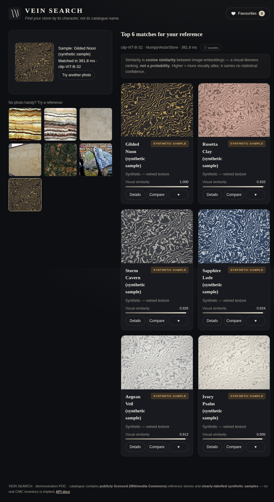
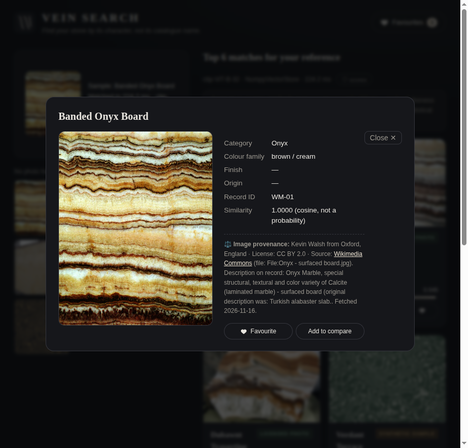
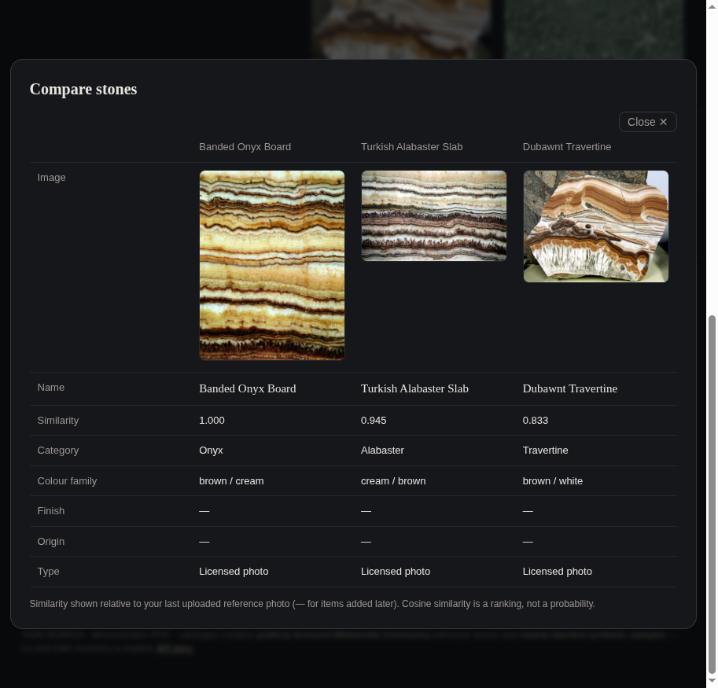
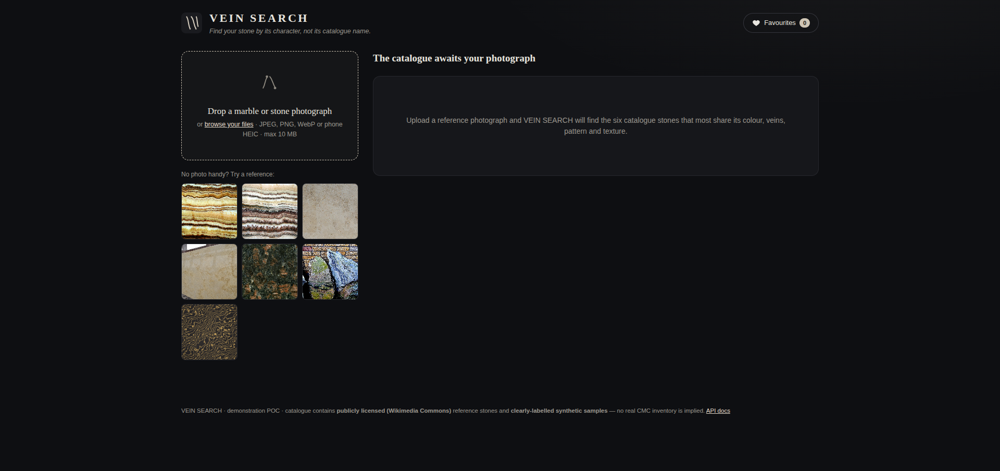

# VEIN SEARCH

**Find your stone by its character, not its catalogue name.**

An AI-powered marble discovery POC: upload a photograph of marble or natural
stone you like, and VEIN SEARCH analyses its visual characteristics — colour,
veins, patterns and texture — and returns the six most visually similar
products from a catalogue, with genuine similarity scores, product details,
comparison and favourites.

## Screenshots

| Search results | Product details |
| --- | --- |
|  |  |

| Compare | Phone photo (HEIC) upload |
| --- | --- |
|  |  |

## Quick start

```bash
# 1. Python 3.10+ environment (no GPU, no Docker required)
python -m venv .venv && source .venv/bin/activate
pip install -r requirements.txt

# 2. Build the catalogue + embedding index (first run only, ~2 min)
python scripts/build_index.py

# 3. Run the app
uvicorn backend.main:app --port 8000
# open http://localhost:8000
```

If you skip step 2 you'll get a clear error telling you to run it — the
catalogue index (54 products, CLIP embeddings) ships prebuilt in
`data/catalogue/` when present.

## Share a demo link (temporary)

To give stakeholders a public URL without deploying anything:

```bash
./scripts/share_demo.sh
```

It starts the app if needed, downloads `cloudflared` once into `.tools/`, and
prints a `https://<random>.trycloudflare.com` link. Details that matter for a
live demo:

- The link exists **only while the script runs** and changes every restart —
  share it right before the session, not days ahead.
- The machine running it must stay awake and online; laptop sleep breaks it.
- It is **public and unauthenticated** — anyone with the link can upload photos.
  Don't leave it open after the demo (Ctrl+C).
- Cold latency through the tunnel is ~0.4 s per page, ~0.3 s per search; the
  CLIP model stays warm in the running process.

If you need a permanent URL instead, the app needs a host with ≥1 GB RAM
(see the deployment note below) — Vercel Functions cap at 500 MB unpacked and
`torch` alone is 1.2 GB, so the FastAPI app cannot run inside a Vercel
function as written.

## Architecture overview

```
                 ┌────────────────────────────────────────────┐
 upload photo ──▶│ FastAPI  backend/main.py                   │
                 │   /api/search        upload → validate →    │
                 │                      embed → search        │
                 │   /api/products     catalogue + metadata   │
                 │   /api/favourites   JSON-file persistence  │
                 │   /api/samples      demo reference images  │
                 └──────┬─────────────────────┬───────────────┘
                        │                     │
        backend/core/embedder.py      backend/core/store.py
        CLIP ViT-B/32 (CPU, 512-d)    VectorStore protocol
                                      └ NumpyVectorStore (cosine)
                        │
                 data/catalogue/
                 products.json + embeddings.npy + images/
```

Key decisions & trade-offs:

- **CLIP ViT-B/32** via `sentence-transformers` — CPU-only (~10–250 ms/query on
  4 cores), strong on colour/texture/pattern. A domain-tuned stone model is the
  obvious future upgrade; the `ImageEmbedder` interface isolates that change.
- **`VectorStore` protocol + `NumpyVectorStore`** — brute-force cosine over a
  NumPy matrix. At ~50 products this is <1 ms and zero infrastructure. Swap in
  FAISS/pgvector/Qdrant by implementing the protocol — nothing else changes.
- **No LLM anywhere** — this is an image-retrieval problem; no text generation
  is needed, which keeps cost, latency and complexity low.
- **No Docker/build toolchain** — one `pip install` + one command.
- **Vanilla JS frontend** served by the API process — zero build steps.

## Data & provenance

The catalogue is deliberately **mixed** (`data/catalogue/products.json`):

| Source | Count | Notes |
|---|---|---|
| Wikimedia Commons | 36 | Real stone/slab photographs, permissive licences only (CC0 / CC BY / CC BY-SA / PD). Full provenance per product: source page, author, licence, local sha256, fetch date. |
| Synthetic | 18 | Procedurally generated textures (`scripts/generate_synthetic.py`, deterministic seeds). **Clearly labelled "Synthetic sample" in the UI and API; never presented as real inventory.** |

- **CMC catalogue assets were not used.** Their images are not demonstrably
  licensed for reuse, so the POC honours "only where their use is permitted".
  Swapping in licensed CMC data is a data-pipeline change only (see
  `scripts/build_index.py`).
- No specifications, origins or certifications were invented: `origin` is
  filled only where the source file title/description states it; everything
  else is `null`.
- Pipeline: `scripts/fetch_catalogue.py` (Wikimedia API + licence filter) →
  manual curation (`data/raw/curated.json`) → `scripts/build_index.py`
  (copy images, embed with CLIP, write products.json + embeddings.npy).
- **Repo note:** the downloaded candidate JPEG/PNGs under `data/raw/wikimedia/`
  are not committed (they are ~67 MB of uncurated leftovers). Re-fetch them
  with `scripts/fetch_catalogue.py`; the manifests (`index.json`,
  `curated.json`) *are* committed, so the curation stays reproducible. The app
  itself runs entirely from `data/catalogue/`, which is committed in full.

## Similarity scores — read this before demoing

Scores are **cosine similarity** between image embeddings, range −1 to +1.
They are a **visual-likeness ranking, not a probability** — there is no
statistical confidence attached, and the UI/API state this explicitly
(`meta.score_explanation`, ⓘ button in the UI).

## Features

- Upload (drag-drop/browse), preview, validation by **magic bytes** (JPEG/PNG/
  WebP **and phone HEIC/HEIF** via pillow-heif), 10 MB cap, decompression-bomb
  guard
- Top-6 visual matches with product image, name, category, colour family,
  finish, origin, synthetic badge, similarity bar + explanation
- Product details with full image provenance/licence
- Compare up to 3 products side-by-side
- Favourites (server-persisted), favourites drawer
- Demo sample strip ("try a reference") for photo-less demos
- Responsive, premium dark UI; interactive API docs at `/api/docs`

## Tests

```bash
python -m pytest tests/ -q
```

26 tests: upload validation (magic bytes, size, type), vector-store contract
(ordering, self-match, normalisation guard, count mismatch), end-to-end API
(health, catalogue integrity, synthetic labelling, self-match top-1, 415/404
handling, favourites round-trip, path-traversal guard).

## Demo script (5 minutes)

1. **Open http://localhost:8000** — note the tagline: discovery by character,
   not catalogue name.
2. **Upload a real photo** (any marble photo on your phone/desktop). Point out
   the preview, ~200 ms turnaround, and the six results with similarity bars.
3. **Click "ⓘ scores"** — stress that scores are cosine similarity, a ranking
   not a probability. Honesty sells the POC.
4. **Open Details** on a result — show provenance/licence block; mention
   synthetic samples are explicitly labelled and CMC assets were deliberately
   not used without permission.
5. **Compare** two results side-by-side; **favourite** one and open the
   favourites drawer.
6. **Click the synthetic sample reference** in the strip — show the engine
   ranks like-for-like textures together (self-match 1.000).
7. Close with: results are genuinely computed per query (no hardcoding), the
   store is a swappable interface, and see "Production-readiness gaps".

## Known limitations (POC scope)

- Similarity is global-image CLIP cosine; it can be colour-biased and is
  sensitive to backgrounds/cropping of the reference photo.
- CLIP is not stone-domain-tuned; micro-texture discrimination is modest.
- Single-process, in-memory index; favourites are a JSON file (no auth,
  no concurrency guarantees).
- Catalogue is small (54) and crowdsourced/licence-based, not CMC inventory.
- No user accounts, ERP/SAP integration, live stock, pricing or payments.

## Production-readiness gaps

| Area | Gap | Direction |
|---|---|---|
| Data | No CMC catalogue/licence agreement | Contract + ingest pipeline, slug-level SKU mapping |
| Model | General CLIP | Fine-tune metric learning on stone pairs; multi-crop/multi-scale embeddings; background removal on uploads |
| Index | NumPy brute force | FAISS or pgvector; quarterly re-index job |
| Serving | Single uvicorn worker | Multiple workers/containers, CDN for images, autoscaling |
| Auth/tenancy | None | SSO, saved searches, per-user favourites in a DB |
| Feedback loop | None | Capture enquiries/clicks → relevance tuning, A/B testing |
| Observability | Console logs only | Structured logging, metrics, tracing, uptime alerts |
| Compliance | Licence attribution only in UI | Full attribution page, DPA, image-usage policy review |
| Tests | API-level only | Load tests, model-quality regression suite (recall@k on labelled pairs), CI |

## Hosting notes (why not Vercel Functions)

The app needs **≥1 GB RAM and a writable disk** because it runs CLIP in-process
and serves catalogue images from `data/catalogue/`. Measured footprint:

| Component | Unpacked |
|---|---|
| `torch` | 1.2 GB |
| CLIP ViT-B/32 weights | ~600 MB |
| `transformers` + `numpy` | ~165 MB |

Vercel Python Functions cap the bundle at **500 MB unzipped**, so this stack
cannot be packaged there as-is. Workable options, cheapest first:

| Option | Notes |
|---|---|
| Temporary tunnel (`scripts/share_demo.sh`) | Zero infrastructure, link dies with the process |
| Hugging Face Spaces (Docker, free CPU) | 16 GB RAM free tier; deploy from this repo |
| Railway / Fly.io | ~1–2 GB RAM tier; both deploy straight from GitHub |
| Render | Free tier is 512 MB (OOMs on CLIP); paid Starter 2 GB works |
| Vercel + ONNX swap | Only if a `*.vercel.app` URL is mandatory — replace torch/CLIP with a quantised ONNX model, rebuild embeddings, revalidate scores |

## Project layout

```
backend/            FastAPI app + core (embedder, store, catalogue)
frontend/           static UI (no build step)
scripts/            fetch_catalogue · generate_synthetic · contact_sheet · build_index · share_demo
data/raw/           curation + synthetic manifests (candidate media re-fetchable)
data/catalogue/     products.json · embeddings.npy · images/
tests/              pytest suite
```
